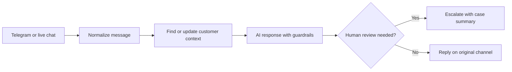

# JANE — Multi-Channel AI Customer Support Agent

**Type:** AI customer-support workflow described in my CV  
**Reported tools:** n8n, OpenAI, Telegram, live chat, structured customer records  
**Public evidence:** Narrative case study only; sanitized export not included

## Problem

Customers contact support through multiple channels. Manually maintaining context, consistent answers and escalation across them can be difficult.

## Approach described in my CV

- Route Telegram and live-chat enquiries into a support workflow.
- Use conversational context and rules for approved answers.
- Apply guardrails against unsupported claims and prompt-injection attempts.
- Use a DataManager sub-workflow to update customer records and enquiry summaries while avoiding duplicates.
- Return responses to the original channel or route cases for human review.

## Illustrative logical flow

## Technical-support relevance

Channel routing, data consistency, multi-step workflow troubleshooting, customer communication and clear human hand-offs.

## Evidence to add only after review

Sanitized n8n exports and reproducible tests for correct-channel replies, unknown pricing, missing identifiers, escalation and credential removal.

*No deployment metrics or quantitative performance improvements are claimed.*
