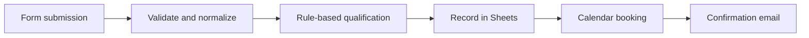

# Intelligent Lead-to-Appointment Automation

**Type:** Operations workflow described in my CV  
**Reported tools:** n8n, Jotform, JavaScript, Google Sheets, Google Calendar, Gmail  
**Public evidence:** Narrative case study only; sanitized export not included

## Problem

Manual intake may lead to inconsistent contacts, unclear priority, missed follow-ups and repetitive scheduling.

## Approach described in my CV

1. Collect structured enquiries with a form.
2. Standardize contact details and parse shorthand budget values.
3. Apply explicit Hot/Warm/Cold routing rules.
4. Write records to the appropriate spreadsheet tab.
5. Schedule consultations and send confirmations.

## Illustrative flow

## Transferable support skills

Consistent intake, transparent case classification, error handling, accurate cross-tool records and customer updates.

## Further evidence

Sanitized screenshots, synthetic submissions, duplicate and invalid-data tests. No unverifiable efficiency gains are claimed.
