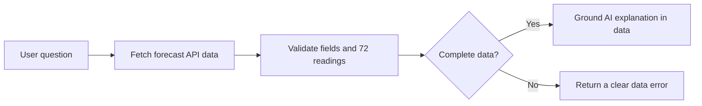

# Manchester AI Weather Assistant — Verified Forecast Pipeline

**Type:** Data-driven AI workflow described in my CV  
**Reported tools:** n8n Cloud, OpenAI, Open-Meteo weather API, JavaScript  
**Public evidence:** Narrative case study only; sanitized export not included

## Problem

AI forecast explanations should not invent readings. Forecast API responses require validation before being used by an assistant.

## Approach

- Fetch current, hourly and daily forecast information from an external API.
- Restrict the assistant to Manchester, UK.
- Validate a 72-hour hourly dataset for completeness.
- Pass structured data into the assistant only after checks succeed.
- Return a clear data error when expected readings are missing.

## Illustrative flow

## Why it matters for technical support

API inspection, explicit failure paths, structured data validation and reproducible issue reporting. No claim is made of accessing external production systems.
